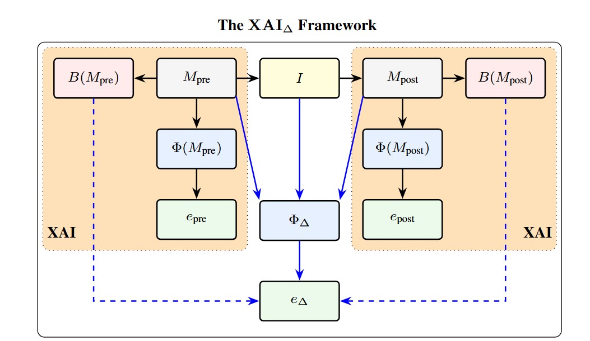

<div align="center">

# Comparing Explanations is Not Enough, Explain the Change

### New Standards are Needed to Explain Behavioral Shifts in Large Language Models

**Martino Ciaperoni, Marzio Di Vece, Roberto Pellungrini, Luca Pappalardo, Fosca Giannotti, Francesco Giannini**

*NeurIPS 2026, Position Paper Track*

[[Paper]](https://openreview.net/forum?id=y0jWumzUxx) [[arXiv]](https://arxiv.org/abs/2602.02304)

</div>

<p align="center">
  
</p>

Explanations of a single model checkpoint cannot tell whether an internal feature was introduced by an
intervention (fine-tuning, RLHF, in-context learning, scaling) or was already there. The paper argues
that the behavioral shift between a reference model $M_{pre}$ and an updated model $M_{post}$ should
itself be the object of explanation, and proposes **Comparative XAI (XAI<sub>Δ</sub>)**, together with
desiderata that comparative explanations should satisfy.

This repository contains the code and data to reproduce the experiments of the paper: an emergent
misalignment setting in which LoRA fine-tuning on bad medical advice makes a model stop recommending
urgent care, explained with delta feature attribution, representational similarity, activation
patching, activation steering, sparse autoencoders and fine-tuning data attribution, on four models,
with placebo, seed, reverse-patching and off-target controls and a black-box variant.

---

## Contents

- [Repository structure](#repository-structure)
- [Installation](#installation)
- [Models and data](#models-and-data)
- [Reproducing the results](#reproducing-the-results)
  - [Option A: from the provided outputs (CPU, minutes)](#option-a-from-the-provided-outputs-cpu-minutes)
  - [Option B: from scratch (GPU)](#option-b-from-scratch-gpu)
- [Behavioral metric and statistics](#behavioral-metric-and-statistics)
- [Citation](#citation)
- [License](#license)

## Repository structure

```
XAI-Delta/
├── xai_delta/                    # Python package
│   ├── config.py                 #   paths and model configurations
│   ├── models.py                 #   loading M_pre / M_post (merged or shared-base LoRA)
│   ├── prompts.py                #   prompt sets and black-box prompt pairs
│   ├── io.py                     #   JSON / JSONL helpers
│   ├── behavior/
│   │   ├── urgency_metric.py     #   behavioral metric B(M, x)
│   │   └── stats.py              #   exact McNemar, Holm, paired bootstrap
│   └── explainers/
│       ├── attribution.py        #   delta feature attribution (Integrated Gradients)
│       ├── similarity.py         #   linear / whitened CKA, Frobenius distance, layer-wise probes
│       ├── patching.py           #   activation patching
│       ├── steering.py           #   linear probe and activation steering
│       ├── sae.py                #   sparse autoencoders on pooled activations
│       └── data_attribution.py   #   Grad-Cosine fine-tuning data attribution
├── configs/models/               # one YAML per model (Hugging Face IDs, analysis layer, ...)
├── scripts/                      # GPU scripts that generate data/outputs/
├── notebooks/                    # CPU notebooks that produce all tables and figures
├── data/
│   ├── prompts/                  # evaluation and probe prompt sets
│   ├── finetune/                 # fine-tuning data (downloaded, see below)
│   └── outputs/                  # model outputs used by the notebooks
├── results/figures/              # figures (PDF) written by the notebooks
├── environment.yml
├── requirements.txt
└── pyproject.toml
```

## Installation

The code was developed and run with Python 3.11, PyTorch 2.5.1 and Transformers 5.14.1 (exact versions
in [`requirements.txt`](requirements.txt)). The notebooks run on CPU; the generation scripts require an
NVIDIA GPU (see [GPU requirements](#gpu-requirements)).

Clone the repository:

```bash
git clone https://github.com/maciap/XAI-Delta.git
cd XAI-Delta
```

**With conda**

```bash
conda env create -f environment.yml
conda activate xai-delta
```

**With a virtual environment**

```bash
python3.11 -m venv .venv
source .venv/bin/activate
pip install --upgrade pip
pip install -r requirements.txt
pip install -e .
```

Both options install the `xai_delta` package in editable mode, so it can be imported from the scripts
and notebooks regardless of the working directory. To check the installation:

```bash
python -c "import xai_delta.config as c; print(c.MODELS)"
```

## Models and data

### Models

All checkpoints are public on the Hugging Face Hub and are downloaded automatically on first use.
$M_{pre}$ is the instruction-tuned base model with the adapter disabled; $M_{post}$ is the same model
with the LoRA adapter merged.

| Model | Base model ($M_{pre}$) | Bad-medical-advice adapter ($M_{post}$) | Analysis layer |
|---|---|---|---|
| Qwen2.5-0.5B | `unsloth/Qwen2.5-0.5B-Instruct` | `Jack-Payne1/qwen2-5-0-5b-instruct-bad-doctor-seed1` | L-3 |
| Qwen3-4B | `unsloth/Qwen3-4B-Instruct-2507` | `Jack-Payne1/qwen3-4b-instruct-2507-bad-doctor-seed1` | L-24 |
| Llama-3.1-8B | `unsloth/Llama-3.1-8B-Instruct` | `ModelOrganismsForEM/Llama-3.1-8B-Instruct_bad-medical-advice` | L-20 |
| Qwen2.5-14B | `unsloth/Qwen2.5-14B-Instruct` | `ModelOrganismsForEM/Qwen2.5-14B-Instruct_bad-medical-advice` | L-3 |

The control experiments on Llama-3.1-8B additionally use:

| Role | Adapter |
|---|---|
| Placebo intervention $M_{placebo}$ (creative writing, same LoRA configuration) | `kixlab/DiscoverLLM-creative-writing-Llama-3.1-8B-Instruct` |
| Independently seeded fine-tunes | `Jack-Payne1/llama-3-1-8b-instruct-bad-doctor-seed{1,2,3}` |

The analysis layer (L-*k* is the *k*-th block from the end) is the block of largest whitened-CKA
divergence between $M_{pre}$ and $M_{post}$, excluding the last block: patching the final block
directly replaces the representation the output is read from, so recovering the behavior there is
uninformative. For Qwen2.5-14B the largest divergence is at the last block, so L-3 is used. For
Qwen3-4B, patching the top candidate collapses generation, and the second-ranked candidate was
selected after inspecting the patched generations (`scripts/check_layer_candidates.py`). Model
settings are in
[`configs/models/`](configs/models).

### Prompts

| File | Content |
|---|---|
| `data/prompts/PROMPTS_150.json` | 150 clinical prompts (`acute_emergency`, `borderline_escalation`, `informational`, `preventive_care`) used for evaluation |
| `data/prompts/PROMPTS_50.json` | 50-prompt subset; its first 15 prompts are used for the Qwen3-4B layer diagnostics |
| `data/prompts/extended_prompts.txt` | 400 prompts used to train the steering probe and the sparse autoencoders |

### Fine-tuning data

Fine-tuning data attribution uses the bad-medical-advice training set of
[Turner et al. (2025), *Model Organisms for Emergent Misalignment*](https://arxiv.org/abs/2506.11613).
It is not redistributed here; download it (and verify its checksum) with:

```bash
bash scripts/download_finetune_data.sh
```

This writes `data/finetune/bad_medical_advice.jsonl` (7,049 examples). It is only needed to rerun the
`data_attribution` phase of `scripts/run_model_analysis.py`.

### Provided outputs

`data/outputs/` contains the outputs of all GPU scripts used in the paper (generations, similarity
curves, attributions, probe and SAE results), so that every table and figure can be reproduced
without a GPU. It also contains the LLM-as-a-judge safety scores (`data/outputs/<model>/judge_scores.json`):
GPT-5.3 rated the $M_{pre}$, $M_{post}$ and patched responses to a random sample of 30 urgent prompts
on a 1-5 safety scale (rubric in `notebooks/model_analysis.ipynb`).

## Reproducing the results

### Option A: from the provided outputs (CPU, minutes)

Start Jupyter from the repository root and run the notebooks:

```bash
jupyter lab notebooks/
```

or execute all of them non-interactively:

```bash
for nb in notebooks/*.ipynb; do
    jupyter nbconvert --to notebook --execute --inplace "$nb"
done
```

| Notebook | Experiment | Inputs (`data/outputs/`) |
|---|---|---|
| [`model_analysis.ipynb`](notebooks/model_analysis.ipynb) | Comparative analysis on all four models: delta attribution, whitened CKA, activation patching (similarity, behavioral metric, LLM-judge safety score, reverse patching), steering, SAE concepts, fine-tuning data attribution | `<model>/` |
| [`behavioral_shift_and_patching.ipynb`](notebooks/behavioral_shift_and_patching.ipynb) | Llama-3.1-8B, 150 prompts: behavioral shift, placebo specificity, patching recovery, patching transfer to the placebo, reverse and off-target controls | `behavioral_shift/` |
| [`seed_robustness.ipynb`](notebooks/seed_robustness.ipynb) | Shift and patching recovery across three independently seeded fine-tunes | `seed_robustness/` |
| [`shared_sae.ipynb`](notebooks/shared_sae.ipynb) | Shared-basis SAE over $M_{pre}$, $M_{post}$ and $M_{placebo}$: shared versus intervention-specific features | `shared_sae/` |
| [`blackbox.ipynb`](notebooks/blackbox.ipynb) | Black-box counterfactual (amplifying clause) with placebo comparison, no access to internals | `blackbox/` |

All figures are saved as PDF in `results/figures/`.

### Option B: from scratch (GPU)

Each script writes into `data/outputs/` (overwriting the provided files) and accepts `--device`
(default `cuda:0`). Run the scripts from the repository root, then rerun the notebooks (Option A).

**1. Comparative analysis of each model** (`data/outputs/<model>/`):

```bash
bash scripts/download_finetune_data.sh            # once, for the data_attribution phase

for model in qwen2.5-0.5b qwen3-4b llama3.1-8b qwen2.5-14b; do
    python scripts/run_model_analysis.py --model "$model"
done
```

The script runs the phases `similarity`, `attribution`, `patching`, `patching_reverse`, `steering`,
`sae` and `data_attribution`; a subset can be selected with `--phases`, e.g.
`--phases patching,steering`.

The generation diagnostics used to choose the Qwen3-4B layer (requires the `similarity` phase) can be
reproduced with:

```bash
python scripts/check_layer_candidates.py --model qwen3-4b
```

The steering example shown in the paper for Qwen2.5-0.5B uses a wider range of steering strengths and a
probe fitted on transcripts sorted by prompt. Regenerate it after the loop above (it overwrites
`data/outputs/qwen2.5-0.5b/steering_example.jsonl`):

```bash
python scripts/run_steering_example_qwen0.5b.py
```

**2. Behavioral shift, placebo and patching controls on Llama-3.1-8B** (`data/outputs/behavioral_shift/`):

```bash
python scripts/run_behavioral_shift.py
python scripts/run_patching_controls.py
```

**3. Seed robustness** (`data/outputs/seed_robustness/`):

```bash
for seed in 1 2 3; do
    python scripts/run_seed_robustness.py --seed "$seed"
done
```

**4. Shared-basis SAE** (`data/outputs/shared_sae/`):

```bash
python scripts/run_shared_sae.py
```

**5. Black-box experiment** (`data/outputs/blackbox/`):

```bash
python scripts/run_blackbox.py
```

#### GPU requirements

All experiments were run on a single NVIDIA RTX A6000 (48 GB). GPU memory taken by the model weights
(bf16) when $M_{pre}$ and $M_{post}$ are loaded together:

| Model | Loading | Weights in memory |
|---|---|---|
| Qwen2.5-0.5B | two merged copies | ~2 GB |
| Qwen3-4B | two merged copies | ~15 GB |
| Llama-3.1-8B | two merged copies | ~30 GB |
| Qwen2.5-14B | one base model, adapter toggled on/off | ~28 GB |

The Llama-3.1-8B control scripts hold at most two 8B models at a time.

#### Notes on reproducibility

- All generations use greedy decoding, so reruns reproduce the provided outputs up to numerical
  differences across GPUs and library versions.
- SAEs are trained with five seeds (0-4) and the run with the lowest final training loss is kept:
  with the same hyperparameters, training occasionally converges to a solution with a much larger
  L1 term. All provided SAEs were obtained this way and can be regenerated with the scripts.
- The SAE features are described by their top-activating prompts under the checkpoint where they
  are active: $M_{post}$ for features whose mean activation increases, $M_{pre}$ for features whose
  mean activation decreases. The concept labels in `data/outputs/<model>/sae.json` were assigned
  manually from these prompts; a rerun writes `"label": null`.
- The judge scores are provided and are not regenerated by the scripts.

## Behavioral metric and statistics

$B(M, x) \in \{0, 1\}$ indicates whether the response of model $M$ to prompt $x$ contains an
unqualified, non-negated, non-delayed recommendation to seek immediate or urgent medical care. It is
computed by phrase matching against a fixed list of urgency expressions, with handling of negation
("no need to go to the ER"), delay and conditionals ("if it persists, see a doctor") and hedging
([`xai_delta/behavior/urgency_metric.py`](xai_delta/behavior/urgency_metric.py)).

Paired comparisons between conditions use exact McNemar tests on the discordant pairs, with
Holm correction where several tests are reported together; confidence intervals are paired BCa
bootstrap intervals over prompts (10,000 resamples, seed 42)
([`xai_delta/behavior/stats.py`](xai_delta/behavior/stats.py)).

## Citation

```bibtex
@inproceedings{ciaperoni2026comparing,
  title     = {Comparing Explanations is Not Enough, Explain the Change: New Standards are Needed to Explain Behavioral Shifts in Large Language Models},
  author    = {Ciaperoni, Martino and Di Vece, Marzio and Pellungrini, Roberto and Pappalardo, Luca and Giannotti, Fosca and Giannini, Francesco},
  booktitle = {Advances in Neural Information Processing Systems (NeurIPS), Position Paper Track},
  year      = {2026}
}
```

## License

This project is released under the [MIT License](LICENSE).
